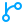

  

  

<a href="#sobre">Sobre</a> &nbsp;·&nbsp;
<a href="#falkyria">Falkyria</a> &nbsp;·&nbsp;
<a href="#metodo">Método</a> &nbsp;·&nbsp;
<a href="#stack">Stack</a> &nbsp;·&nbsp;
<a href="#stats">Estatísticas</a> &nbsp;·&nbsp;
<a href="#contato">Contato</a>

 

##  Sobre mim

Sou desenvolvedor full stack e gosto de problemas que pedem o sistema inteiro: a regra de negócio, o banco, a interface, o deploy e a documentação que explica por que cada decisão foi tomada.

Sob a marca **Falkyria**, transformo ideias em produtos completos. Sou apaixonado por inteligência artificial, por jogos e por software que respeita quem usa.

**Foco** &nbsp; Full stack, do banco ao pixel 
**Interesses** &nbsp; IA, jogos e dados públicos 
**Linguagens** &nbsp; TypeScript, Python, PHP, C#, C++, Java 
**Marca** &nbsp; Falkyria

 

##  Falkyria

Falkyria é a marca sob a qual eu crio meus produtos: software independente, feito no Brasil, com testes, documentação de verdade e cada decisão de arquitetura registrada.

<table>
  <tr>
    <td width="33%" valign="top">
       
      <b>Privacidade por padrão</b> 
      Quando dá para rodar no seu computador, roda no seu computador.
    </td>
    <td width="33%" valign="top">
       
      <b>Regras explícitas</b> 
      Motores puros e testados, decisões em ADRs, nada escondido em mágica.
    </td>
    <td width="33%" valign="top">
       
      <b>Prova antes da conclusão</b> 
      Todo número aponta para a fonte; o sistema mostra evidências, não acusações.
    </td>
  </tr>
</table>

 

Um assistente que conversa em português, por texto e por voz, e roda inteiro na sua máquina: privado, sem custo por uso e sem nuvem. Guarda fatos sobre você e os documentos que você indexar, e tem agentes de briefing diário, pesquisa com fontes e monitoramento.

 

Rotina, estudos, trabalho, treinos e hábitos viram progressão de longo prazo: níveis com dificuldade crescente, atributos, missões, moedas, loja, conquistas e temporadas. Motor de gamificação próprio, web (PWA) e Android, com 151 testes automatizados e 7 de ponta a ponta.

 

Não existe motor de regras, de propósito: o sistema move peças, sincroniza estado e esconde informação, e quem aplica as regras é a mesa, como numa partida de verdade. Estado da partida em tempo real no Colyseus, entrada por token assinado de uso único e aleatoriedade auditável.

 

Coleta, normaliza e analisa dados de entes federativos (PNCP, IBGE, SICONFI e TSE) para sinalizar o que merece atenção de órgãos de controle, imprensa e sociedade. Publica indícios, nunca conclusões, e cada número carrega o SHA-256 da cópia baixada da fonte.

 

##  Como eu trabalho

<table>
  <tr>
    <td width="50%" valign="top">
       
      <b>Documentar antes de codar</b> 
      Visão, requisitos, casos de uso e modelo de dados escritos primeiro. Decisões de arquitetura viram ADRs, com o motivo registrado.
    </td>
    <td width="50%" valign="top">
       
      <b>Regra de negócio isolada e testada</b> 
      O núcleo não conhece banco nem interface. Motor puro, testes de unidade, integração com banco real e ponta a ponta no navegador.
    </td>
  </tr>
  <tr>
    <td width="50%" valign="top">
       
      <b>CI que não deixa passar</b> 
      Lint com tipos e zero aviso, typecheck, testes, build, E2E e imagens Docker. Git Flow, Conventional Commits e versões com tag.
    </td>
    <td width="50%" valign="top">
       
      <b>Custo zero para rodar</b> 
      Arquitetura pensada para camadas gratuitas: GitHub Actions como servidor de carga, armazenamento de objetos e hospedagem estática.
    </td>
  </tr>
</table>

##  Stack

<table>
  <tr>
    <td width="150"><b>Linguagens</b></td>
    <td></td>
  </tr>
  <tr>
    <td><b>Front-end</b></td>
    <td></td>
  </tr>
  <tr>
    <td><b>Back-end</b></td>
    <td></td>
  </tr>
  <tr>
    <td><b>Dados</b></td>
    <td> </td>
  </tr>
  <tr>
    <td><b>Qualidade e DevOps</b></td>
    <td> </td>
  </tr>
</table>

##  Estatísticas

  

<picture>
  <source media="(prefers-color-scheme: dark)" srcset="https://raw.githubusercontent.com/Dracon-46/Dracon-46/output/github-contribution-grid-snake-dark.svg" />
  <source media="(prefers-color-scheme: light)" srcset="https://raw.githubusercontent.com/Dracon-46/Dracon-46/output/github-contribution-grid-snake.svg" />
  
</picture>

##  Contato

  

*Aquele que não prevê o futuro distante expõe-se a desgraças próximas.* 
<b>Sun Tzu</b>

 

<a href="#topo"> Voltar ao topo</a>

